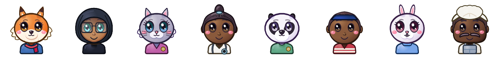
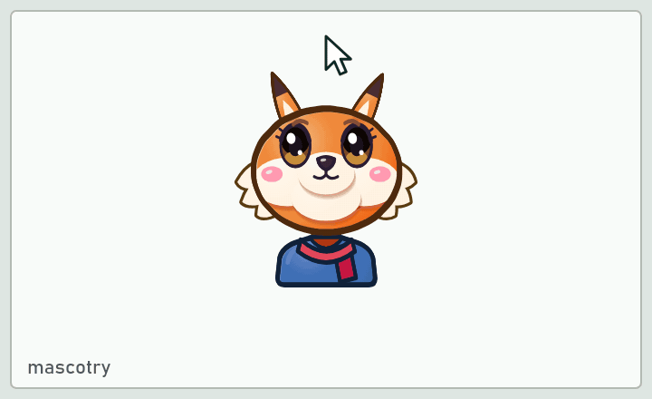
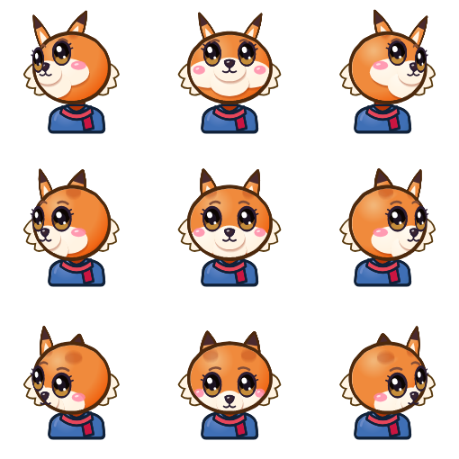
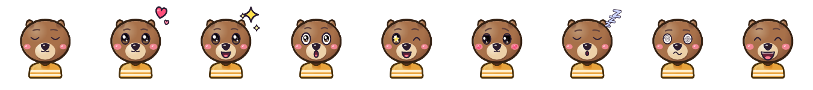
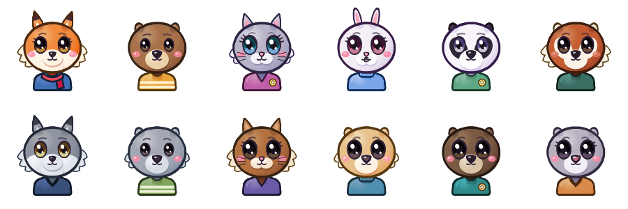
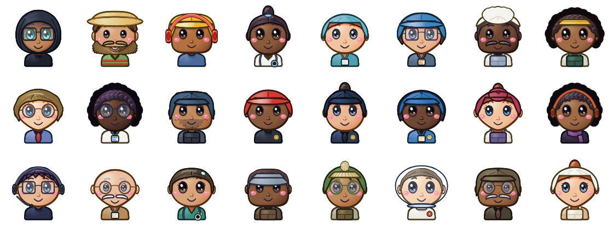
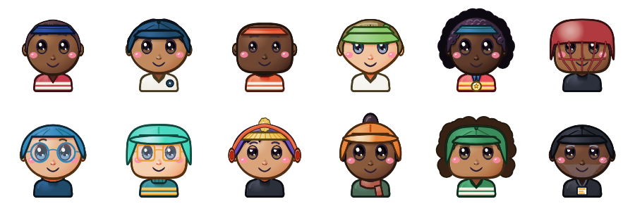
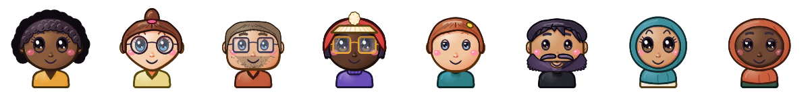

<div align="center">

# Mascotry

**Draw a mascot that watches the reader.**

A friendly character for the top of your page. It follows the cursor, and it reacts when you poke it.





Free, no account, no API key, nothing uploaded. Every character is drawn by code in your own browser.

</div>

---

## What it is

Pick a character, change its face, and leave with two sprite sheets and the handful of lines that make them follow the cursor. Drop those on any site — React, plain HTML, anything.

There is no service behind this. The drawing happens in your tab, the files are yours, and nothing is sent anywhere.

## How a character is built

Every mascot is two 3×3 sprite sheets. The first holds nine head directions:



The second holds nine moods, shown when someone pokes it:



At runtime the component measures where the pointer sits relative to the mascot and shifts the background to the matching cell. Two image loads, no layout work per frame.

The torso is drawn once and reused across all eighteen cells, so the body never shifts while the head turns.

## Make your mascot

Open **[the studio](https://lihancancode.github.io/Mascotry/)**. Nothing to install, nothing to sign up for.

**1. Start a character.** Three doors, and they all end up in the same place:

- **Pick one** of the fifty-seven.
- **Describe it** — type `curly dark hair, round glasses, short beard, green jumper` and watch it appear. It is a keyword parser over 344 phrases, not a model, so it is instant and works offline. It tells you which of your words it did not understand.
- **From a photo** — drop in a head-and-shoulders photograph and it reads your skin tone, hair colour and style, beard, glasses and shirt colour. The photo is read in the tab and never uploaded. It wants a plain background, and when it cannot find a face it says so rather than guessing.

**2. Tune it.** Colours, ears, face shape, hair, glasses, facial hair, headwear, eye size. Every change redraws all eighteen poses live.

**3. Check the preview.** Move your pointer around it and click it. What you see is exactly what your visitors will get.

**4. Export.** Pick a size — 256 for a small corner mascot, 360 for most things, 512 if it will be displayed large — and download. You get four files:

| File | What it is |
|---|---|
| `yourname-directions.webp` | The nine head poses |
| `yourname-reactions.webp` | The nine expressions |
| `mascotry-mascot.js` | The element, for any site |
| `mascotry-react.js` | The component, for React |

You only need one of the last two. If your webp downloads arrive as `.png` instead, that is Safari, and everything below works the same — just keep the extension you actually got.

## The characters

### Animals


### Professions


### Sports


### People


These eight are starting points rather than finished characters — the doorway into the studio.

## Put it on your site

### Step 1 — put the files where your site serves static files

This is the only step people get wrong, and it is always the same mistake: the files are somewhere the browser cannot reach. Where "static" lives depends on what you built your site with:

| Your site | Put the files in |
|---|---|
| Plain HTML | The same folder as your `index.html` |
| Vite, Astro, SvelteKit | `public/` |
| Next.js | `public/` |
| Create React App | `public/` |
| Jekyll / GitHub Pages | The repository root, or `assets/` |
| Hugo | `static/` |
| WordPress | Upload through Media, then use the URLs it gives you |

The snippets below assume the files sit at the root of your site, so `/pip-directions.webp` resolves. If you put them in a subfolder, add it to every path: `/assets/pip-directions.webp`.

### Step 2 — paste the snippet

**Any website, no build step, no framework.** Put this where you want the mascot to appear:

```html
<script type="module" src="/mascotry-mascot.js"></script>

<mascotry-mascot
  directions="/pip-directions.webp"
  reactions="/pip-reactions.webp"
  size="140"
  label="Pip"></mascotry-mascot>
```

**React.** Drop `mascotry-react.js` in with your components and import it:

```jsx
import { Mascot } from './mascotry-react.js'

export function Header() {
  return (
    <header>
      <h1>My portfolio</h1>
      <Mascot
        directions="/pip-directions.webp"
        reactions="/pip-reactions.webp"
        size={140}
        label="Pip"
      />
    </header>
  )
}
```

**Next.js.** The same, but the component needs to run in the browser, so mark the file that uses it:

```jsx
'use client'
import { Mascot } from './mascotry-react.js'
```

The app's export step writes both snippets out with your own file names already filled in — copy from there rather than editing these by hand.

### Step 3 — put it somewhere it earns its place

On a portfolio, the three spots that work:

- **Beside your name in the header**, at `size="120"`. It greets people without getting in the way.
- **Next to your About paragraph**, at `size="160"`, so it reads as you.
- **In the corner of a hero section**, larger, at `size="200"` or more.

Give it room. It wants about 30px of breathing space to look deliberate rather than crammed. And one is plenty — a page with three mascots looks like a mistake.

### Options

| Attribute / prop | Default | What it does |
|---|---|---|
| `directions` | required | Path to the poses sheet |
| `reactions` | required | Path to the moods sheet |
| `size` | `128` | Width and height in pixels |
| `label` | `mascot` | What a screen reader announces |
| `class` / `className` | — | Your own styling hook |

### If it does not appear

**A broken image icon, or nothing at all.** The paths are wrong. Open your browser's devtools, look at the Network tab, and see what URL it actually asked for. Nine times in ten the files are in a subfolder and the path says `/`.

**It shows but never turns.** That is correct on a touch device — there is no cursor to follow, so it stays still on purpose. Check on a desktop with a mouse.

**The head moves but clicking does nothing.** The reactions sheet did not load. Same fix as the first one: check the path.

**It looks blurry.** The sheet was exported smaller than you are displaying it. Re-export at 512 and keep the same `size`.

### Good to know

It respects `prefers-reduced-motion`, so it stays calm for anyone who has asked their system for less movement. It is a real `<button>` with a label, so screen readers announce it properly. It works under a strict Content Security Policy, because all styling goes through the CSSOM rather than inline style tags. And it makes no network requests of its own — once the two images load, nothing else is fetched, ever.

## Run it

```bash
pnpm install
pnpm dev          # the studio
pnpm test         # 1173 unit and integration tests
pnpm typecheck
pnpm build        # static site in dist/
pnpm e2e          # browser tests
```

`pnpm dev` also serves a demo page at `/demo.html`: a made-up allotment association's website with a mascot on its shelf, built from the same files this repo ships.

Deploy `dist/` to any static host.

## How it is put together

| Path | What |
|---|---|
| `src/studio` | The drawing rig: the 2.5D face projection, the parts, the lighting, the presets |
| `src/runtime` | The `<Mascot>` component, the custom element, and the pointer and poke logic |
| `src/describe` | Words to a character |
| `src/photo` | A photograph to a character |
| `src/app` | The studio itself |
| `docs/roster.md` | What is built, what is planned, and what each character costs to draw |

### A note on the drawing

Characters are not images with the colours swapped. A config describes the face — ears, muzzle, hair, glasses, facial hair, headwear, accessories, colours — and the rig projects the features onto a sphere to turn the head, lights every form from the upper left, derives each outline from the colour it surrounds, and breaks up fur and hair along the silhouette. That is why a character can be recoloured and restyled after you pick it, and why a new one costs a few lines rather than a drawing.

## Known limits

- **Koala, hamster, otter and mouse** look like recoloured bear cubs. The rig has one round ear, and they want their own.
- **Owl, penguin, dog, tiger, deer and the objects** are planned but unbuilt: they need a beak, a snout, droopy ears, markings and a second head shape. `docs/roster.md` lists what each costs.
- **The photo route refuses ordinary snapshots** taken against warm backgrounds. It is honest about it, but a sliding-window face search would fix it.
- Eye colour, glasses shape and a moustache-versus-beard distinction are never guessed from a photo, because none of them can be measured honestly without facial landmarks.

## Licence

MIT, © 2026 LihanCanCode.

Every line of code and every pixel of artwork here is original work written for this project. There is no third-party code and there are no borrowed assets.
